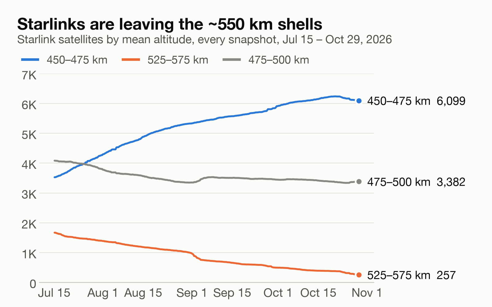
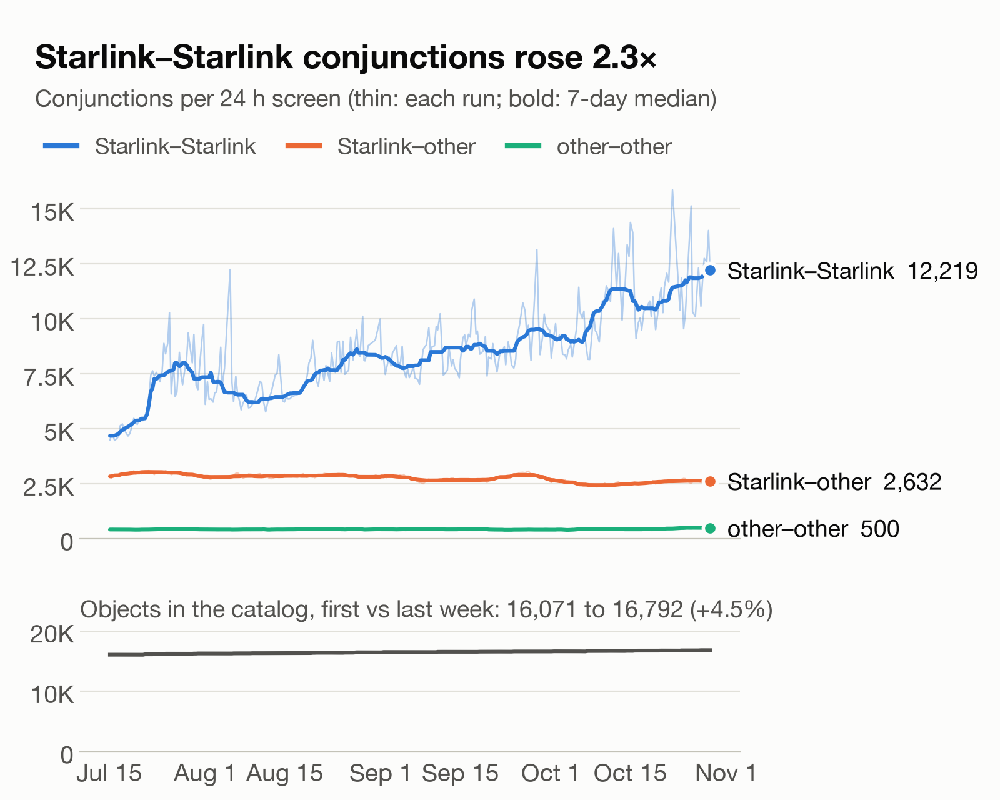
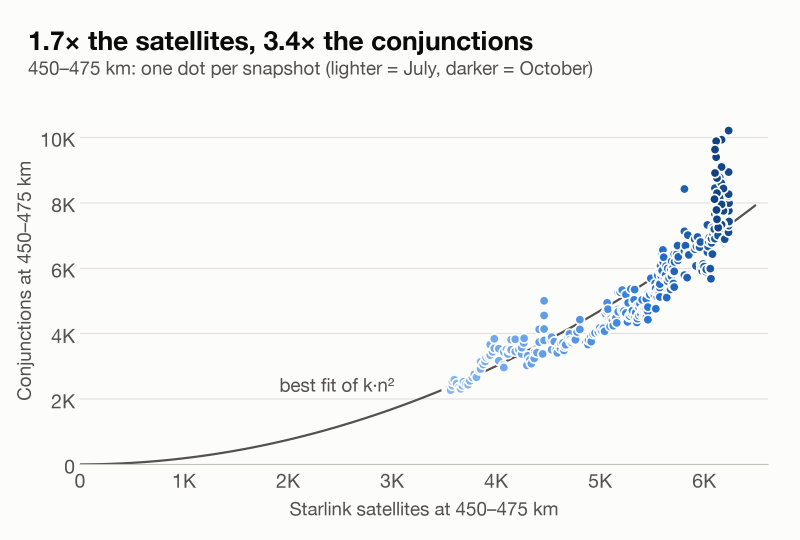

> **Draft — not yet published.**

# Starlink is moving down a shell, and Starlink-on-Starlink close approaches more than doubled

Between mid-July and late October 2026, my conjunction screener's public archive recorded SpaceX emptying its ~550 km Starlink shells: Starlinks at 525–575 km fell from 1,669 to 257, while the 450–475 km band grew from about 3,500 to 6,100. Over the same 15 weeks, Starlink–Starlink conjunctions per 24-hour screen rose 2.3×, while the number of tracked objects grew only 4.5%.

SpaceX announced this in January 2026: about 4,400 Starlinks would drop from roughly 550 km to roughly 480 km during the year, so that failed satellites re-enter sooner. OrbitWatch adds an independent, reproducible record of the move as it happened, and of what it did to the conjunction picture.

## The shells are moving, not being replaced

A shrinking band could just mean old satellites decaying while new ones launch elsewhere. Tracking individual satellites by catalog number rules that out. Of the 1,669 Starlinks at 525–575 km on July 15, 1,297 are now at 450–500 km, 55 are still descending through 500–525 km, 58 are below 450 km, 257 are still at 525–575 km, and only 2 have left the catalog.

From the other end: of the 6,099 Starlinks at 450–475 km on October 29, 3,268 were already there in July, 2,161 came down from above, and 670 came up from below (336 new to the catalog since July 15, 334 still raising their orbits then). The band is also more mixed. In July it held mostly 53°-inclination satellites (2,834) plus a polar group at 97° (677); it now holds 4,255 at 53°, 1,458 at 97°, and 372 at 70°.

## Conjunctions followed them

Median run in the first week of full-catalog data (July 15–21) against the last week (October 22–29):

| Per 24-hour screen | First week | Last week | Change |
|---|---:|---:|---:|
| Starlink–Starlink conjunctions | 5,154 | 11,896 | ×2.31 |
| Starlink–other conjunctions | 2,986 | 2,651 | ×0.89 |
| Other–other conjunctions | 426 | 506 | ×1.19 |
| All conjunctions | 8,464 | 15,106 | ×1.78 |
| Objects in the catalog | 16,071 | 16,792 | ×1.04 |

Starlink–Starlink pairs went from 61% to 79% of all flagged events, and in every run 94–98% of events involve at least one Starlink. Conjunctions between a Starlink and anything else drifted slightly down.

## Why: pairs grow with the square of the crowd

The number of possible pairs in a shell grows with the square of its population, so a shell that gains satellites gains conjunctions faster. In the 450–475 km band, Starlinks rose 1.7× and conjunctions 3.4×. Across all 296 runs, a power-law fit of the band's conjunctions against its population gives an exponent of 2.03 (r = 0.94).

That is a strong pattern, not a full explanation. In the last two weeks the band's population levelled off near 6,100 while its conjunctions kept climbing, and the neighbouring 475–500 km band saw conjunctions rise 11% while its Starlink count fell 17%. Satellites in transit crossing other shells, and three inclination groups now sharing one altitude, are plausible contributors that I have not tested.

## What it does and does not mean

A flagged conjunction is a geometric close approach inside a screening volume, not a predicted collision. In a Starlink–Starlink pair, one operator flies both satellites, using an autonomous collision-avoidance system; SpaceX reports hundreds of thousands of avoidance maneuvers a year to the FCC. The doubling is mostly extra coordination work inside SpaceX's own fleet, accepted in exchange for faster cleanup of dead satellites. The count that measures exposure for other operators, Starlink–other, went slightly down.

## How this was measured

[OrbitWatch](https://jtemblador.github.io/OrbitWatch/) is a conjunction screener built on a from-scratch C++ SGP4 propagator. Three times a day a GitHub Actions job fetches CelesTrak's "active" catalog (about 16,800 objects), screens 24 hours ahead on a 30-second grid using the screening volumes from the 18th/19th SDS Spaceflight Safety Handbook (LEO and GEO; MEO and HEO objects are shown but not screened), publishes the result to the live site, and archives a gzipped copy to an orphan `data` branch. On epoch-matched elements the screener reproduces CelesTrak's SOCRATES to 0.000 km.

This analysis reads all 318 archived snapshots (July 8 – October 29); screen settings were identical in the 296 it uses. Altitude is orbit-averaged (from mean motion, above Earth's equatorial radius), so it won't match SpaceX's round shell numbers; on this scale the lowered shells settle at 460–475 km. "Starlink" means the object name starts with STARLINK; a pair's altitude is the average of its two objects'.

To reproduce: `git fetch origin data && python scripts/analyze_archive.py` (about a minute). Per-run numbers are in [archive_trends.csv](archive_trends.csv).

## Caveats

- **Screening, not risk.** No covariance means no probability of collision. These are geometric flags.
- **Element accuracy.** Public SGP4 elements are good to roughly 1 km at epoch and degrade by a few km per day, so any single miss distance is uncertain at the kilometre level. The trends aggregate about 3.5 million flagged events over 296 runs (windows overlap, so many are one encounter seen repeatedly).
- **Counts depend on the volume.** Other screening volumes give other absolute counts; compare trends, not totals, across tools.
- **Excluded runs.** The first 22 snapshots (July 8–14) screened only 5,000 objects and are left out.
- **Gaps and noise.** 24 of 319 eight-hour cron slots (7.5%) have no snapshot, chiefly from CelesTrak fetch failures. Single runs are noisy (the last week ranged from 12,829 to 18,998 events), so the comparisons use weekly medians.
- **Correlation, not mechanism.** The archive shows the same satellites moving and conjunctions rising with the square of the band's population. It cannot show intent, and the late-October rise says headcount is not the only driver.

Live site: https://jtemblador.github.io/OrbitWatch/ · Code and data: https://github.com/jtemblador/OrbitWatch

## Sources

- Space.com, "SpaceX lowering orbits of 4,400 Starlink satellites for safety's sake": https://space.com/space-exploration/satellites/spacex-lowering-orbits-of-4-400-starlink-satellites-for-safetys-sake
- Space.com, "Every SpaceX Starlink satellite has to dodge a collision almost weekly, and experts fear the worst": https://space.com/space-exploration/satellites/every-spacex-starlink-satellite-has-to-dodge-a-collision-almost-weekly-and-experts-fear-the-worst
- CelesTrak, GP element sets: https://celestrak.org/NORAD/elements/
- CelesTrak, SOCRATES: https://celestrak.org/SOCRATES/
- 18th & 19th Space Defense Squadrons, *Spaceflight Safety Handbook for Satellite Operators*, v1.7, Table 3 (distributed via Space-Track): https://www.space-track.org/
- Vallado, Crawford, Hujsak & Kelso, "Revisiting Spacetrack Report #3," AIAA 2006-6753: https://celestrak.org/publications/AIAA/2006-6753/
- NASA, *Spacecraft Conjunction Assessment and Collision Avoidance Best Practices Handbook*: https://ntrs.nasa.gov/citations/20205011318
- OrbitWatch, SGP4 and public-element uncertainty: https://github.com/jtemblador/OrbitWatch/blob/main/validation/sgp4_uncertainty.md
- OrbitWatch, SOCRATES validation report: https://github.com/jtemblador/OrbitWatch/blob/main/validation/socrates_report.md
